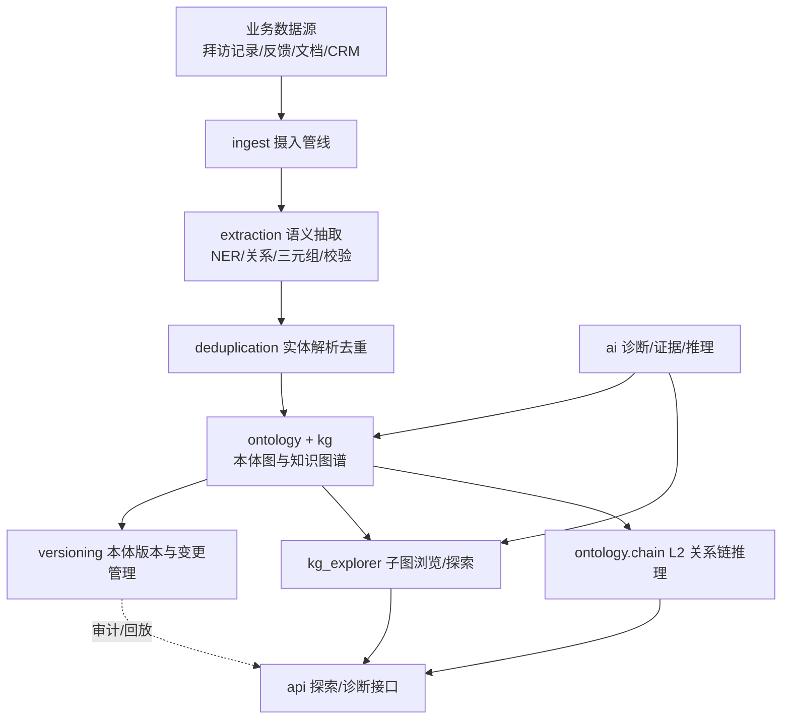
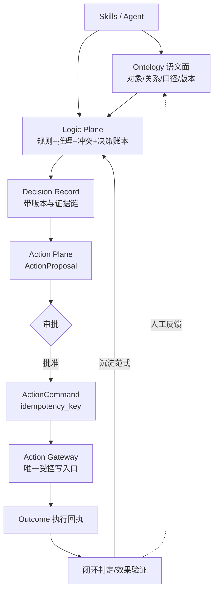

# SalesClaw Backend 架构重组蓝图

---

## 1. 为什么要做这次梳理

SalesClaw backend 经过多轮迭代，已积累：
- `ontology/`：8 个文件，本体运行时权威源 + L2 推理
- `ai/`：约 30 个模块（诊断/信号/推理/证据/agent/rag/skill/tools…）
- `services/`：**46 个 service 文件**
- `api/`：**28 个路由子模块** + 顶层 `auth.py`/`ontology.py`/`portal.py`/`profile.py`

规模大、边界开始模糊。典型痛点（来自探查）：
1. **service 层散落**：46 个 service 按文件名命名，缺乏域分组（诊断、知识、主数据、合规、通知等混在同一扁平目录），新成员难定位。
2. **AI 能力孤岛**：`ai/` 内部抽取、推理、RAG、证据各自为政，没有统一的"语义抽取契约"，拜访记录/反馈/文档的实体与关系抽取没有集中子系统。
3. **本体缺乏版本与变更审计**：`registry.py` 已支持热更新与租户覆盖，但无版本快照、无变更日志、无 checksum —— 无法回放"本体的某次变更影响了哪些推理"。
4. **图谱浏览与推理耦合**：`chain.py` 既做遍历又做归因，探索类查询（邻域/子图）与归因推理未分层。
5. **摄入与去重缺位**：数据进入本体图的流程散落在各 service，无统一管线，也无实体解析/去重机制（同一实体多写法会建出多个节点）。

---

## 2. SalesClaw 现状盘点（已探查）

### 2.1 ontology/（运行时权威源 + L2 推理）
- `objects.py` / `links.py` / `actions.py`：seed 声明源（30+ Object / 含 cardinality 的 Link / 75+ Action）。
- `registry.py`：`OntologyRegistry` 单例，权威源翻转架构（seed→DB→缓存），`_ListProxy`/`_MapProxy` 向后兼容，TTL=300s、租户覆盖、热更新 `reload()`。✅ 架构已很成熟。
- `chain.py`：`infer_relation_chain()` 沿 Link 有界多跳 BFS，`_depth_decay()` + `_CARDINALITY_WEIGHT`，`_locate_root_cause()`。纯规则、无 LLM。✅ 核心能力稳固。
- `permissions.py` / `permission_registry.py`：RBAC+OBAC+ABAC，同构于 registry 的 DB 权威源模式。
- `__init__.py`：统一导出层 + `get_graph()`，已采用重导出（轻量懒加载）。

### 2.2 ai/（诊断与智能层）
`diagnosis / signal / reasoning / evidence / agents / rag / skills / tools / orchestrator / intent_classifier / self_reflection / hallucination_detector / quality_gates / exclusion_gate / safety_valves / reasoning_chain / memory_service / metrics_collector / event_bus / event_subscribers` 等。能力丰富，但**缺统一的语义抽取子系统**（实体/关系抽取散落各处，无契约）。

### 2.3 services/（46 个，扁平无域分组）
代表性：`ai_diagnosis_service`、`ai_insight_service`、`knowledge_service`、`knowledge_distill_service`、`mdm_service`、`rule_version_service`、`data_lineage_service`、`compliance_service`、`phase3_compliance_service`、`notification_service`、`audit_service`、`decision_service`、`crm_service`、`sales_service`、`training_service` … 跨度极大，无目录分层。

### 2.4 api/（28 路由子模块 + 4 顶层）
按业务域已较好分组：`academic / activity / ai / audit / cfm / collab / collection / compliance / context / crm / data_quality / decision / experience / knowledge / mdm / notification / observability / partner / persona / platform / ppt_speech / sales / scenario / settings / tools / training`。✅ api 层已按域分目录，相对清晰。

### 2.5 导入约定（必须尊重）
- backend **无顶层 `__init__.py`**，全部**根相对导入**：`from config import settings`、`from ontology.registry import *`。
- 任何重组不能破坏此约定，新增子包要能被根相对导入直接解析。

---

## 3. 目标架构蓝图

### 3.1 数据流（mermaid）



### 3.2 目标目录

```
backend/
├── ontology/          # 现状保留：对象/关系/权限/注册表/L2 推理
│   ├── objects.py  links.py  actions.py
│   ├── registry.py           # 运行时权威源（已成熟）
│   ├── chain.py              # L2 推理（与探索解耦，保留）
│   ├── permissions.py  permission_registry.py
│   └── __init__.py           # 统一导出（推广懒加载门面）
│
├── extraction/        # [规划] 语义抽取子系统（借鉴 semantic_extract）
│   ├── providers/     # LLM 厂商抽象（ProviderRegistry + 工厂）
│   ├── methods/       # 实体/关系/三元组抽取方法（MethodRegistry：task×name）
│   ├── validators/    # 抽取质量校验（类比 ExtractionValidator）
│   ├── config.py      # 抽取参数集中配置
│   └── __init__.py    # __getattr__ 懒加载导出
│
├── ingest/           # [规划] 摄入管线（借鉴 ingest + deduplication）
│   ├── pipelines/     # 阶段化：检测→抽取→去重→落本体图
│   ├── sources/       # 拜访记录/反馈/文档/CRM 适配器
│   └── config.py
│
├── deduplication/    # [规划] 实体解析与去重（借鉴 deduplication）
│   ├── similarity.py  # SimilarityCalculator（多因子）
│   ├── detector.py    # DuplicateDetector
│   ├── merger.py      # EntityMerger（策略模式）
│   └── registry.py    # 方法 registry
│
├── kg_explorer/      # [规划] 图谱探索面（借鉴 explorer，与 chain 解耦）
│   ├── neighbors.py   # 邻域查询（上游/下游/双向）
│   ├── subgraph.py    # 子图剪裁与过滤
│   └── analytics.py   # 中心性/社区/桥检测（借鉴 kg.GraphAnalyzer）
│
├── versioning/       # [规划] 本体版本与变更管理（借鉴 change_management）
│   ├── checksum.py    # compute/verify_checksum
│   ├── changelog.py   # OntologyChangeLog + ChangeLogEntry
│   ├── storage.py     # VersionStorage（内存/SQLite）
│   └── manager.py     # OntologyVersionManager
│
├── ai/               # 现状保留：诊断/信号/推理/证据/agent…
├── services/         # 现状：建议按域收敛（见 §5.3）
├── api/              # 现状保留：已按域分目录
└──
```

### 3.3 边界与职责（关键契约，供后续实现参考）

```python
# extraction/__init__.py —— 懒加载门面
_LAZY_EXPORTS = {
    "NERExtractor": (".methods", "extract_entities"),
    "RelationExtractor": (".methods", "extract_relations"),
    "TripletExtractor": (".methods", "extract_triplets"),
}
def __getattr__(name): ...   # 首次访问才 importlib 加载

# extraction/methods.py —— task×name 二维注册
method_registry.register(task="entity",    name="llm",    fn=extract_entities_llm)
method_registry.register(task="relation",  name="llm",    fn=extract_relations_llm)
method_registry.register(task="triplet",   name="llm",    fn=extract_triplets_llm)

# versioning/checksum.py
def compute_checksum(data) -> str:   # 确定性 JSON(sort_keys+紧凑) → SHA-256
    ...
def verify_checksum(snapshot) -> bool: ...

# versioning/changelog.py
class OntologyChangeLog:
    version: str
    checksum: str
    changed_by: str
    entries: list   # 每次 OBJECT/LINK/ACTION 变更记录一条

# deduplication/similarity.py
# 多因子：name 相似(Levenshtein/Jaro-Winkler) + 属性加权 + 关系集合 Jaccard

# kg_explorer/neighbors.py —— 与 chain.py 解耦的探索查询
def get_neighbors(object_name, direction="both", max_depth=2) -> dict:
    # 只读遍历，不复用归因权重，返回 {nodes, edges}
```

---

## 4. 逐方向映射（思想 → 本系统自建落点）

### 4.1 语义抽取（NER/关系/三元组）
- 三级 registry + 懒加载 + 配置 fallback。
- 统一契约：输入文本 → 输出 `{entities, relations, triplets}`，由 `MethodRegistry` 按 `task×name` 调度（llm / rule / pattern）。Provider 抽象 LLM 厂商，便于换模型不碰业务代码。

### 4.2 本体版本与变更管理
- `compute_checksum`/`verify_checksum`、`ChangeLogEntry`、`VersionStorage`（内存/SQLite）、`OntologyVersionManager`。
- 在现有 `registry.py` 热更新机制之上叠加：每次本体变更生成带 SHA-256 的快照 + 变更日志条目，支持列出版本、比对差异、校验完整性、回放。
- registry 已有 `_ListProxy`/`_MapProxy` 与租户覆盖，版本化是其自然的演进方向。

### 4.3 知识图谱浏览/探索
- 新建 `kg_explorer/`，把 `ontology/chain.py` 里"遍历"职责拆出为只读探索查询（邻域/子图/过滤），归因推理仍留在 `chain.py`。`analytics.py` 复用 GraphAnalyzer 思路做图分析。
- 前端 `OntologyPage` 的探索类查询走 `kg_explorer`，不触发归因权重计算，性能与语义更清晰。

### 4.4 摄入管线与去重
- 新建 `ingest/`（检测→抽取→去重→落本体图）+ `deduplication/`（实体解析）。解决"同一实体多写法建多节点"的问题，统一数据进入本体图的入口。
- 现有散落在 services 的导入逻辑可逐步收敛到 `ingest/pipelines`。

---

## 5. 迁移路线（分阶段，零中断）

| 阶段 | 目标 | 范围 | 风险 |
|------|------|------|------|
| **P1 抽取子系统** | 建 `extraction/` 门面 + registry + 一个 llm 方法 | 新增，不影响现有 | 低（纯新增） |
| **P2 图谱探索解耦** | 抽 `kg_explorer/`，`OntologyPage` 探索查询迁过去 | 复制遍历逻辑，chain 保留 | 中（需回归前端） |
| **P3 版本与审计** | 建 `versioning/`，接 registry 变更钩子 | 新增 + 轻改 registry | 低 |
| **P4 摄入与去重** | 建 `ingest/` + `deduplication/`，收敛散落导入 | 新增 + 收敛 | 中（需数据一致性验证） |
| **P5 service 域分组** | `services/` 按域分目录（diagnosis/knowledge/mdm/compliance/notification…） | 仅移动 + 改 import | 中（需全量 import 校验） |

**兼容性红线**：全程根相对导入不变；`ontology/registry.py`、`chain.py` 作为已成熟核心保持不动（仅在其上叠加）。

---

## 6. 风险与注意事项

1. **根相对导入约束**：新增子包必须能被根相对导入解析；`__init__.py` 若引入 `__getattr__` 懒加载，需与现有 `ontology/__init__.py` 重导出风格一致，避免 import 顺序问题。
2. **不破坏 L2 推理性能**：`chain.py` 的 BFS+cardinality 衰减是 OAG 核心能力，探索解耦后归因路径不得回归。
3. **service 移动成本**：P5 的目录收敛涉及 46 个文件的 import 改动，需配合 IDE 重命名/全量测试，建议放最后且小步提交。
4. **数据一致性**：P4 去重会改变实体节点合并行为，需在低峰期灰度并保留合并溯源（借鉴 `deduplication` 的 provenance 保留）。

---

## 7. Ontology → Logic → Action 主线改进（核心闭环）

前文四个方向都落在 **Ontology（语义面）**。但主线是 **Ontology → Logic → Action → Skills → Outcome → 回流校准**，并把系统分为三层平面：

| 平面 | 承载内容 | 关键契约 |
|------|----------|----------|
| **Semantic Plane** | 对象、关系、事件、指标、时间、来源 | Ontology 版本库、Context Graph |
| **Logic Plane** | 口径、规则、图推理、时序推理、解释 | 规则仓库 + **规则执行账本** |
| **Action Plane** | 提案、审批、执行、补偿、Outbox | **ActionProposal / ActionExecution / ActionCommand（幂等键）** |

当前 SalesClaw 在 Logic 与 Action 上已有**扎实雏形但未分层**：

- **Logic（已有资产）**
  - `services/rule_version_service.py`（F5）：规则草稿→发布前检查→影子运行→提升→回滚→时间点回放，已含版本生命周期与差异快照。**这正是建设方案 Logic Plane "规则执行账本"的雏形。**
  - `ai/reasoning_chain.py`：推理链。
  - `services/decision_service.py`：KPI 监控 / 归因分析 / 模拟推演 / 预警中心。
  - `services/ai_diagnosis_service.py`、`ai_insight_service.py`：诊断与洞察。
- **Action / Outcome（已有资产，闭环已成形）**
  - `services/diagnosis_loop_service.py`：诊断 → 两级归因（个人/团队）→ 培训建议。
  - `services/followup_loop_service.py`：全链路状态机 **诊断建议 → 执行中 → 效果验证 → 闭环判定 → 范式沉淀**，下游依赖 `effect_tracking_service` 与 `closure_review_service`。
  - 支撑表：`DecisionExecution`、`SuggestionAction`、`Task`、`ClosureReviewCycle`（已存在）。
  - 设计原则与建设方案一致：**不自动执行，所有状态变更需 API 触发（合规人工留痕）**，与 Action Plane "经授权后才执行" 完全吻合。

### 7.1 目标子包（Logic / Action 落点）

```
backend/
├── logic/              # [规划] Logic Plane：规则 + 推理 + 冲突 + 决策账本
│   ├── rules/          # 规则仓库（吸纳 rule_version_service 的版本/影子/回滚）
│   ├── reasoners/      # 确定性/图/时序/溯因 推理器（借鉴 reasoning/ 分层）
│   ├── conflicts/      # 规则矛盾检测（借鉴 conflicts/）
│   ├── decisions/      # 决策账本 + 先例检索（借鉴 decision_models/query）
│   └── ledger.py       # 规则执行账本（每次推理可回放）
│
├── action/             # [规划] Action Plane：提案/审批/执行/补偿/Outbox
│   ├── proposal.py     # ActionProposal 模型
│   ├── command.py      # ActionCommand 契约 + idempotency_key（sha256）
│   ├── gateway.py      # Action Gateway（受控回写，唯一写入口）
│   ├── ledger.py       # Action/Execution Ledger（不可变执行记录）
│   └── outbox.py       # 补偿/重试 Outbox
│
└── (Skills 编排层由现有 ai/agents + api 承担，不重复建)
```

### 7.2 改进要点（对照建设方案）

1. **Logic 分层**：把 `rule_version_service` 的规则能力与 `reasoning_chain` 的推理能力，按"确定性规则(L2) / 图&时序推理(L3) / LLM 溯因假设"分层；LLM 产出仅作"候选假设"，不进入生产审批闸。
2. **规则执行账本**：每次规则触发/推理都写一条带 `ontology_version + mapping_version + metric_version` 的账本记录，实现"证据先于结论、可回放"。
3. **ActionCommand 幂等契约**：所有经 Gateway 的写操作必须携带 `idempotency_key = sha256(action_type, target, period, input_hash)`，避免重复执行（建设方案 §5.3 重点）。
4. **Action Gateway 唯一写入口**：收敛 `followup_loop` 等"下游出口"，所有业务回写经 Gateway，杜绝 LLM/Agent 直写物理层。
5. **范式沉淀→Logic 回流**：`followup_loop` 的"范式沉淀"经审批后，作为新规则/新推理策略回流到 `logic/rules`，闭合 **Outcome → Logic 校准** 环。
6. **冲突前移**：把 `rule_version_service` 的发布前检查升级为通用 `logic/conflicts` 检测器，覆盖规则间矛盾、阈值冲突、口径不一致。

### 7.3 主干闭环 mermaid



---

## 8. 横切与基础设施层

### 8.1 统一内核骨架（core）—— 消灭散落的 os.getenv 与 if-else 分派

- 多源配置（YAML/JSON + 环境变量 + 编程式）+ 回退链 + 全局单例 |
- 文件系统自动发现、版本与依赖解析、load/unload 全生命周期 |
- 按 task 注册自定义方法，O(1) 查找 |
- 优先级 hook、状态机、组件健康聚合 |

新建 `backend/core/`，只定义**一套** `Registry` 基类 + `ConfigManager` + `LifecycleManager`，供 `extraction / logic / export / visualization / stores` 全复用。SalesClaw 当前各 service 里散落的 `os.getenv` 与插件分支，统一收敛到此处。

### 8.2 横切溯源层（provenance）—— 销售洞察可信度与合规底座

新建 `backend/provenance/`。作为所有写操作（抽取→切分→导出→分析→API）的**统一血缘入口**，opt-in 不侵入业务。销售洞察的"证据先于结论、可回放、可审计"直接受益——这与 §8 的 Logic 决策账本同源，应合并为一条贯穿全链路的溯源主线。

### 8.3 存储抽象（stores）—— 后端可替换，业务不解耦

- 先定抽象再挂后端，业务代码不耦合具体图库 |
- 销售语义检索用统一接口 + 混合检索 |
- 若保留 RDF/ontology 推理，复用其注入防护 |

新建 `backend/stores/{graph,vector}/`，定义 `GraphStore`/`VectorStore` 抽象与后端工厂。`api/` 的查询端口若保留 SPARQL，套用 explorer 的"白名单查询类型 + 禁止 UPDATE 关键字扫描 + 注释剥离防绕过 + 只读投影"防护。

### 8.4 管线编排（pipeline）—— 把 ingest→extract→dedup→resolve→store 变成 DSL

规划的 `ingest/` 管线，直接套用此 DSL——失败是否阻断整条管线建模为可配置策略，而非硬编码 try/except；"标准销售线索清洗管线"做成模板一键复用。

### 8.5 归一化（normalize）—— 数据干净一致再抽取

并入 `ingest/` 的预处理阶段。客户名/公司名拼写变体、合同货币、报价日期格式等，直接复用"协调器+引擎"与分桶 registry 模式。

### 8.6 导出与报告（export / report_generator）

SalesClaw 的"销售洞察报告"复用"模板渲染 + 质量指标聚合 + 图表"三层结构；导出格式与配置同样走 §9.1 的统一 Registry+Config 范式。

### 8.7 可视化（visualization）—— 看板后端可插拔

`backend/visualization/`（或前端服务层）驱动洞察看板，比前端硬编码图表更易扩展。

### 8.8 探索 API 形态（explorer）—— 直接长成销售洞察查询端口

 `kg_explorer/` 与 `api/` 重组，定义领域路由 + 线程安全 session + 扫描上限，直接长成邻域/子图/路径/统计/搜索 API。这把"探索"与 §8 的"归因推理"彻底解耦。

### 8.9 零侵入暴露（mcp_server）—— 对 LLM 生态的入口

新建 `backend/mcp_server/`，让外部 AI 助手直接查销售洞察，作为对 LLM 生态的入口层，零侵入。

### 8.10 切分与解析（split / parse）—— 溯源从第一步接上

并入 `ingest/` 的接入阶段；合同/邮件/报表等多源销售文档接入时，切分与解析从第一步就接上 §9.2 的溯源。

### 8.11 治理门禁（governance / change_management / SHACL）

把 ontology/数据模型变更纳入**版本管理 + SHACL 校验 CI 门禁**（技术治理），并配套定义清晰的变更流程与版本节奏（流程治理），防止销售本体失控。

### 8.12 横切层价值排序

1. 统一 `core/`（Registry + ConfigManager + Lifecycle）—— 消灭散落配置与分派
2. `provenance/` 横切溯源（PROV-O + SQLite + 校验和 + WithProvenance 包装）—— 可信与合规底座
3. `graph_store/vector_store` 后端工厂切换 —— 业务解耦具体图/向量库
4. `explorer` API 形态（邻域/路径/距离带解释/防 OOM/线程安全）—— 长成查询端口
5. `pipeline` 编排（失败分级/重试/并行/模板）—— ingest 管线 DSL
6. `normalize` 归一化 —— 干净数据再抽取
7. `export/report_generator` —— 洞察报告质量自检
8. `llms/` 薄封装 + LiteLLM 路由 —— 统一 generate 接口（agent 并入 ai 层，不另起 agents/）
9. `visualization` 可插拔 Visualizer —— 看板后端
10. `mcp_server` 零侵入暴露 —— LLM 生态入口
11. 技术治理门禁（change_management + SHACL）—— CI 防线
12. 社区治理模型（RFC + 语义版本）—— 团队流程

---

## 9. 结论

SalesClaw backend 已有成熟的本体权威源（`registry.py`）、L2 推理（`chain.py`），初具规模的 **Logic（`rule_version_service`/`reasoning_chain`/`decision_service`）** 与 **Action 闭环（`diagnosis_loop`→`followup_loop`→`effect_tracking`→`closure_review`）**。

本次重组把系统显式分层为 **Semantic / Logic / Action 三层平面 + 横切基础设施层**，围绕主线补齐长期缺失的子系统边界：

- **Semantic 面**：`extraction / ingest / deduplication / kg_explorer / versioning`
- **Logic 面**：`logic/`（规则仓库 + 分层推理器 + 冲突检测 + 决策账本 + 规则执行账本）
- **Action 面**：`action/`（Proposal / Command 幂等 / Gateway 唯一写入口 / Execution Ledger / Outbox）
- **横切/基础设施**：`core/`（统一 Registry+Config+Lifecycle）、`provenance/`（PROV-O 溯源）、`stores/{graph,vector}/`（后端工厂）、`pipeline`（编排 DSL）、`visualization/`、`mcp_server/`、治理门禁
